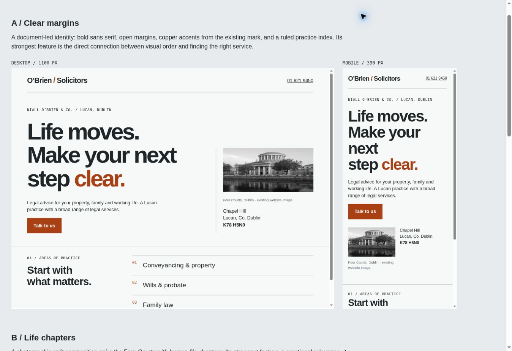
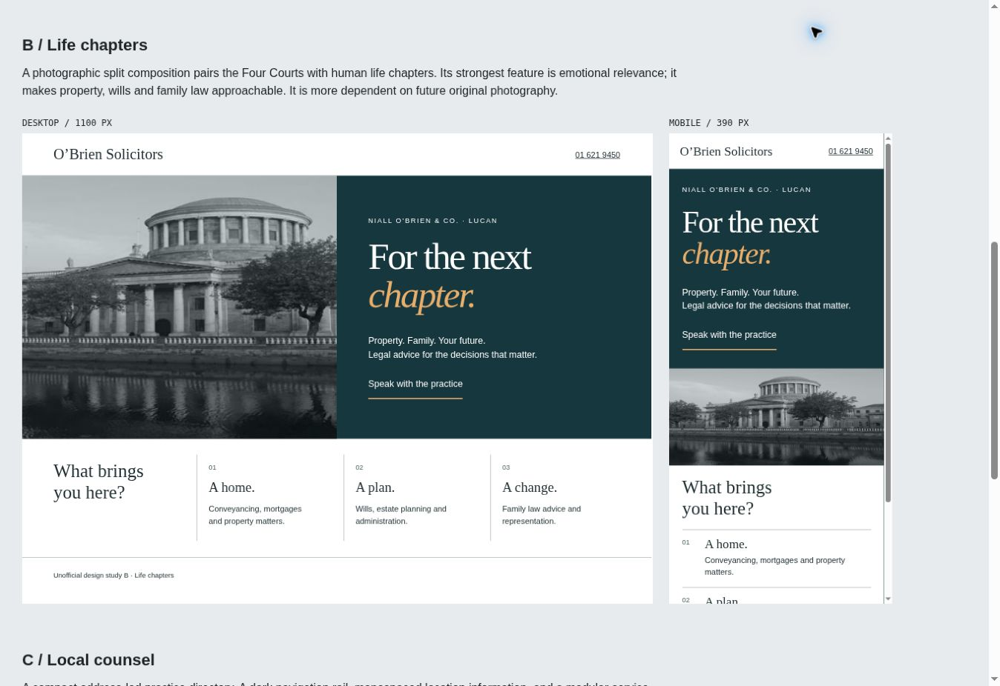
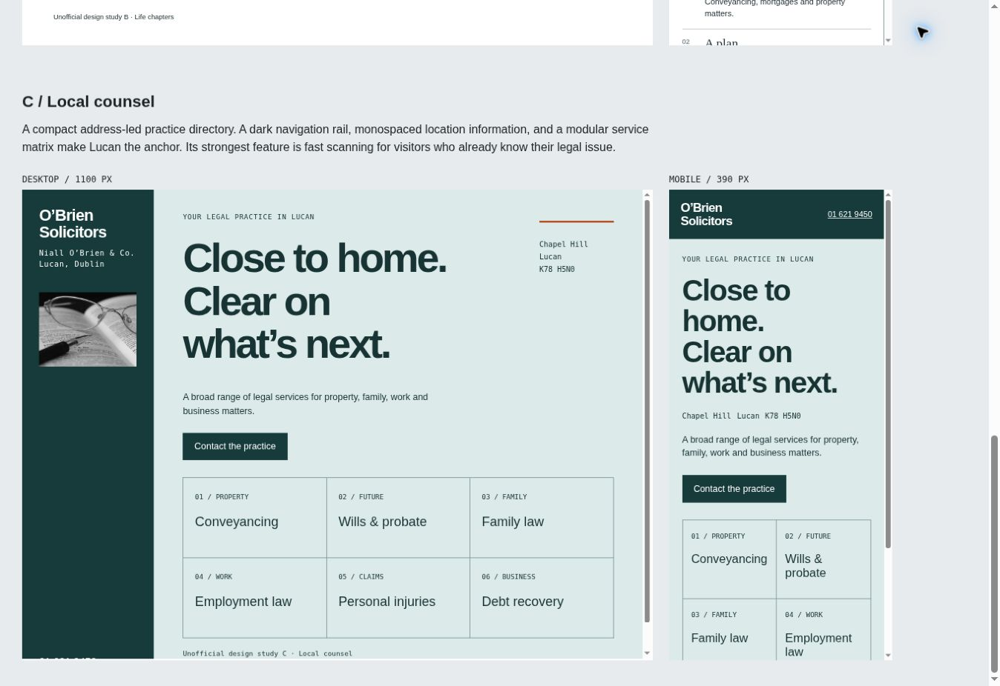

# O’Brien Solicitors — research, design and handover

Prepared 9 October 2026. This is independent public-source research and an unofficial design proposal, not an approved business rebrand or legal opinion.

## Verified business

This is the **Lucan, Ireland** practice, not the similarly named Australian firm. The existing website identifies **Niall O’Brien & Co. Solicitors** and publishes the following details.

| Fact | Verified information | Source |
|---|---|---|
| Business model | Solicitor practice providing legal services; no shop or product catalogue found | http://obriensolicitors.com/index.html and http://obriensolicitors.com/practice-areas.html |
| Office | Chapel Hill, Lucan, Co. Dublin, K78 H5N0 | http://obriensolicitors.com/contact.html |
| Telephone | 01 621 9450; international link +353 1 621 9450 | http://obriensolicitors.com/contact.html |
| Email | info@obriensolicitors.com | http://obriensolicitors.com/contact.html |
| Other contact | Fax 01 621 9446; DX 102004 Lucan | http://obriensolicitors.com/contact.html |
| Wills and probate | Wills, estate planning, estate administration | http://obriensolicitors.com/willsandprobate.html |
| Property | Purchase, sale, mortgages and other property matters; navigation also labels tax | http://obriensolicitors.com/conveyancing.html |
| Family | Separation, divorce, civil partnerships, access, custody and maintenance | http://obriensolicitors.com/familylaw.html |
| Personal injuries | Published examples include road, workplace, equipment and other injury matters | http://obriensolicitors.com/personalinjuries.html |
| Employment | Employee/employer matters, contracts, termination, redundancy, discrimination | http://obriensolicitors.com/employment.html |
| Debt recovery | Proceedings and enforcement, including District, Circuit and High Court work | http://obriensolicitors.com/debtrecovery.html |
| Landlord and tenant | Disputes and residential/commercial lease work | http://obriensolicitors.com/tenantlaw.html |
| Recruitment | Existing page lists no vacancies; present position should be confirmed | http://obriensolicitors.com/recruitment.html |

No fees, prices, verified reviews, awards, founding date, qualifications, staffed office hours, booking system, payment link, official social accounts or current team biography were established. None was invented. The homepage makes broad claims about institutional and corporate work; the concept does not expand these into unsupported case studies or statistics. Expertise is presented through the actual published scope of practice, rather than unverified superlatives.

**Inference:** the published mix suggests local individuals and families making property, estate, family and employment decisions, alongside employers, landlords and businesses with debt or tenancy matters. The decision journey is likely “does this practice cover my situation, where is it, how can I contact it?” This is a design hypothesis based on the content, not customer research. Lucan is the verified office location; no nationwide coverage promise has been added. Language is plain Irish English.

**Main action:** call or email the practice with a brief outline. The concept offers service browsing as the supporting action. It makes no online booking or response-time promise.

## Inspection and concise audit

The original home, about, practice directory, all seven practice pages, contact and recruitment pages were fetched and inspected. Navigation and linked assets were reviewed. Requests for `robots.txt` and `sitemap.xml` returned 404; no sitemap was available at those conventional paths. Original HTTP pages were accessible in the research environment. HTTPS retrieval was unreliable here, so this report does not claim that the site is unavailable to ordinary visitors.

Useful content retained: the service taxonomy and substantive scope, the address and complete contact details, the seven existing service URLs, the recruitment URL, the small orange/grey brand mark, the Four Courts photograph and the illustrative paperwork image.

Five evidence-based problems addressed:

1. **Small-screen foundation:** the inspected stylesheet specified a 1040px outer layout and the homepage had no viewport meta tag. The new pages use responsive layouts and a designed mobile header. This is a source finding, not a claim about traffic or conversion loss.
2. **Finding the right service:** the original homepage opens with broad corporate wording. The concept puts recognisable personal situations alongside the actual practice areas and places call/email information early.
3. **Outdated legal details:** the original family page describes a four-year divorce separation requirement; current Courts Service guidance describes two of the previous three years. Old employment tribunal references and “proposed” personal insolvency wording also require updating. The concept removes these procedural specifics rather than dispensing new legal advice. Sources: https://www.courts.ie/guides/understanding-divorce and https://www.workplacerelations.ie/en/news-media/workplace_relations_notices/employment_appeals_tribunal_change_of_address.html . Owner/legal review is still required.
4. **Reading and navigation semantics:** inspected source used image-based navigation and generic image/title text. The new site uses labelled text navigation, logical headings, explicit active states, meaningful image alternatives, focus indicators and individual page descriptions.
5. **Trust information gaps:** no current business privacy/regulatory notice or usable team biography was found among the inspected pages. The concept openly states its status and handles enquiry data locally. Approved policies, team information and rights confirmation remain owner requirements; fictitious proof has not been used to fill those gaps.

No existing-site performance score, ranking loss or lost-customer estimate was measured or claimed.

## Reference research

The references supplied techniques, not templates or assets. Ireland, the UK and Spain cover relevant domestic/European markets; a US studio and an adjacent furniture business widen the compositional research.

| Reference URL | Specifically observed technique | Original adaptation | Purpose |
|---|---|---|---|
| https://hayes-solicitors.ie/ | Desktop image/text split; a contrasting navy section begins across the image boundary; telephone/email remain prominent | Contact information stays readily available; the charcoal practice section provides a strong change in reading rhythm | Immediate contact access and purposeful section transitions |
| https://www.algoodbody.com/services | A dedicated, organised service taxonomy rather than relying on a promotional homepage | A complete seven-area index, retaining service URLs and adding situation-based descriptions | Let visitors identify relevant expertise |
| https://bateswells.co.uk/ | Primary/utility navigation separation and concise taxonomy labels above prominent resource headings | Separate practice navigation from footer information; numbered labels introduce service and action sections | Distinguish enquiry tasks from reference material |
| https://www.garrigues.com/en_GB | Live page structure exposed task-based service, office and professional selectors | A simpler direct index appropriate to a single verified office and seven areas | Reduce choices without pretending this is a large international firm |
| https://www.vitsoe.com/gb/606 | An interior page explains planning and ownership in short, task-based stages | Three practical visitor actions: find an area, get in touch, discuss needs | Explain how to begin without inventing a solicitor’s delivery process |
| https://order.design/index | Ruled archive rows combine project labels, type and year; the index makes taxonomy a visual composition | Readable numbered rows combine legal area, personal situation and a consistent action | Make the actual breadth of work memorable and easy to scan |

Access limits: Hayes, Bates Wells, Order’s index and Vitsœ’s interior page were visually inspected in the cloud browser at desktop size. A&L Goodbody’s service structure and Garrigues’ selectors were inspected through page content/DOM; Garrigues’ screenshot remained at a loading state, so no detailed visual judgment is claimed for it. Some reference imagery was slow or blurred in this environment. Reference mobile layouts were not comprehensively inspected. The concept’s own mobile layouts were rendered and reviewed independently. No reference branding, photography or proprietary code was reused.

## Three rendered studies

Each standalone study contains an opening, an actual service-content section and responsive mobile rules. `studies.html` displays simultaneous desktop and mobile renderings. The screenshots below were captured from those rendered studies, not generated mockups.

### A — Clear margins

**Proposition:** give ordinary legal decisions the clarity of a well-organised document. Strong sans-serif lines, open margins, numbered clauses and a ruled service index connect the actual practice content to an easy next action. The existing orange/grey mark informs the copper accent; a compact Four Courts image locates the subject in Irish law without implying that it is the office.

**Strongest feature:** the service directory is both the distinctive composition and the customer’s route into the site. **Suitability:** works with the verified content and limited authentic imagery, and carries naturally into all seven service pages.

### B — Life chapters

**Proposition:** frame legal services around changes in life: a home, a plan, a change. A large landscape crop and a more literary serif/italic composition create an expressive opening; chapter-like content groups become a vertical sequence on mobile.

**Strongest feature:** an emotionally legible connection between services and life decisions. **Suitability:** a credible direction for the firm’s personal work, though a richer long-term photographic programme would help it represent business and dispute work equally well.

### C — Local counsel

**Proposition:** make the Lucan address the stable reference point. A persistent dark side rail holds identity and location, while a contrasting main field presents large service language and a compact service matrix. On mobile the rail becomes a deliberate identity/contact header rather than a squeezed sidebar.

**Strongest feature:** a recognisable local anchor with dense, efficient browsing. **Suitability:** practical for a broad local practice, with a more utilitarian tone and less narrative range than A or B.

### Selection

These are subjective art-direction scores out of five, not measured business results.

| Criterion | A | B | C |
|---|---:|---:|---:|
| Business relevance | 5 | 4 | 5 |
| Visual distinctiveness | 4 | 5 | 4 |
| Craft | 5 | 5 | 4 |
| Customer clarity | 5 | 4 | 5 |
| Mobile quality | 5 | 4 | 4 |
| Feasibility with verified content | 5 | 4 | 5 |

**Selected: Clear margins.** It connects legal-document organisation, the retained mark, Irish legal imagery and the seven-area taxonomy. Visitors should feel oriented and able to take the next step. It offers expressive composition without needing invented team photographs, testimonials or case histories. This is a proposed visual interpretation, not an invented account of the firm’s history or internal methods.

## Design system and content journey

| Element | Concrete rule |
|---|---|
| Typography | Local Arial/Helvetica bold for composed headings and readable body text; Courier New for numbered labels. Desktop hero uses large, left-aligned lines; mobile uses a separate three-line scale. Body text starts at 16px. |
| Grid | Maximum width 1440px; fluid 22–76px margins; asymmetric home opening; 1:2 introduction/index split; 2:1 service body/contact column; considered single-column mobile variants |
| Colour | Ink `#202628`, cool paper `#f8f9f9`, copper `#a64016`, pale blue-grey `#e7edf0`, muted text `#586267` |
| Rhythm | Broad introductory space, denser ruled directory, large charcoal typographic section, shorter practical guidance, copper closing action |
| Images | Two official-site images only, converted to WebP. Monochrome treatment gives the limited imagery a consistent role. Captions identify the Four Courts and the illustrative paperwork image. |
| Navigation/buttons | Text navigation with active underlines; a familiar mobile menu; sharp rectangular 48px primary buttons; direct phone/email links |
| Signature | Copper clause numbers, document rules and open margins repeat in the directory, service scopes, guidance, labels and contact panels |
| Motion | Short hover/focus feedback; smooth anchor movement only where permitted. Reduced-motion CSS disables transitions and smooth scrolling. No scroll reveals, parallax or scroll hijacking. |

The journey is multi-page because each legal area has useful substantive content and an existing URL. Home gives orientation; the directory lets visitors choose; each service page explains scope, offers a practical initial-enquiry prompt and presents contact actions; Contact provides the full published details and an unsent draft flow. The closing action follows the same typography and numbered-document language as the opening.

There are fourteen business pages plus the study overview. The full site retains the selected study’s asymmetry, restrained photograph scale and ruled service presentation. Its long page varies density and contrast rather than repeating interchangeable cards. Substituting another business name would require changing the Lucan identity, retained mark and imagery, seven-area scope, situations, page content and customer journey.

No generated image was necessary. The photographs are not presented as the firm’s premises, staff, clients or completed work. Asset sources: http://obriensolicitors.com/images/four.jpg , http://obriensolicitors.com/images/property1.jpg and http://obriensolicitors.com/images/logo.png . Rights must be confirmed before a business launch.

## Verification results

The actual website was reviewed in the cloud browser at a 1363px desktop width and in same-origin responsive frames set to 320, 390, 768 and 1160px. This browser’s 15px scrollbar leaves corresponding content widths of 305, 375, 753 and 1145px. These are real rendered responsive frames, not mobile-device emulation.

- Home’s full desktop page was visually reviewed from opening to footer. Mobile home, contact and conveyancing layouts were reviewed; the wide conveyancing page was also inspected.
- No horizontal overflow was found at the tested normal-text widths. Enlarged 200% text exposed wrapping issues in the brand and concept link; these were fixed. Home and Contact then fitted the 375px content viewport at 200% text.
- Pointer and keyboard menu activation, Escape closing and focus return were checked. Native FAQ disclosure was operated with the keyboard. Visible focus styling was inspected.
- Required-field and invalid-email rejection were checked with synthetic test data. Valid entries prepared a draft and explicitly said nothing was sent. Editing entries hid the old draft. No email was sent during testing.
- The static check passed **311 local references** across 15 top-level HTML files, including assets and fragment targets. Each had one h1, a language, viewport and noindex directive. Images had alt attributes and reserved dimensions.
- No site-owned console error was observed. Browser-extension metadata errors were excluded from that conclusion.
- Measured uncompressed core home files: **88,749 bytes** for HTML, CSS, JS, mark and primary image; **137,425 bytes** including the lazy-loaded second image. The tiny favicon and HTTP headers are outside these totals. There are **zero runtime package dependencies** and no remote font requests.
- Calculated text-token contrast: ink/paper **14.54:1**, muted/paper **5.93:1**, white/copper **6.24:1**, copper/paper **5.91:1**. These token calculations are not a complete accessibility certification.
- Reduced-motion and no-JavaScript fallbacks were inspected in source. They were not tested through browser emulation. No Lighthouse, screen-reader, real-device, load-test or field-performance audit was available; no performance score or Core Web Vitals claim is made.

Reproduce the static checks with `npm run check`. The review harness at `docs/qa/review.html` provides width and text-size controls. Browser screenshots are included under `docs/screenshots`.

## Publication and outstanding owner requirements

The deliverable is prepared for branch-based GitHub Pages publishing. Follow the exact settings in the root README. It contains no custom domain configuration. The official domain has not been modified. Source upload and Pages activation are distinct; a public preview must be verified after Pages is enabled before claiming success.

For launch, the owner must approve rewritten content and current service availability, confirm the scope of tax work and recruitment status, confirm asset rights, provide regulatory and privacy wording, and authorise any form backend. Genuine team details and office photography would improve the practice page if available. Any future submission integration must have explicit data-handling and enquiry-destination decisions. The current draft flow remains functional without that integration.

## Final-platform choices, left open

Prices below were checked on official pricing pages on 9 October 2026. They are provider-listed USD prices, not euro quotations; taxes, domain renewal, implementation, integrations and maintenance are additional where applicable.

| Platform | Owner editing and function | Maintenance | Recurring cost evidence |
|---|---|---|---|
| Static site | This exact implementation preserves full creative control. Edits currently require changing source and regenerating HTML; an authorised form service or CMS can be added later. | Small dependency footprint, but a developer handles changes and integrations. | GitHub Pages is available for public repositories on GitHub Free. Suitable here for the requested concept preview. https://docs.github.com/en/pages/getting-started-with-github-pages/about-github-pages |
| Webflow | Visual editing, hosted forms and a potential structured content workflow. The bespoke layout would need a considered rebuild, not a theme swap. | Hosting/platform updates managed; integration and content governance still need ownership. | Basic **$15/month billed yearly**; the official pricing page lists **Premium $25/month billed yearly** for CMS needs. Workspace/editor seats can add cost. https://webflow.com/pricing |
| WordPress.com / WordPress | Broad editing and plugin options; a custom theme can preserve the design. More useful if the owner expects regular publishing or integrations. | Managed hosting reduces server tasks; theme/plugin changes and backups still need a care plan. | WordPress.com Personal is listed at **$4/month with annual billing** ($9 monthly; lower rates require longer commitments). Verify the final plan’s theme/workflow requirements before purchase. Hosting elsewhere and ongoing care costs vary. https://wordpress.com/pricing/ |

The likely deciding factor is how often the owner will edit content and whether a secure enquiry system or publishing programme is needed. No platform purchase or final-platform commitment has been made.
